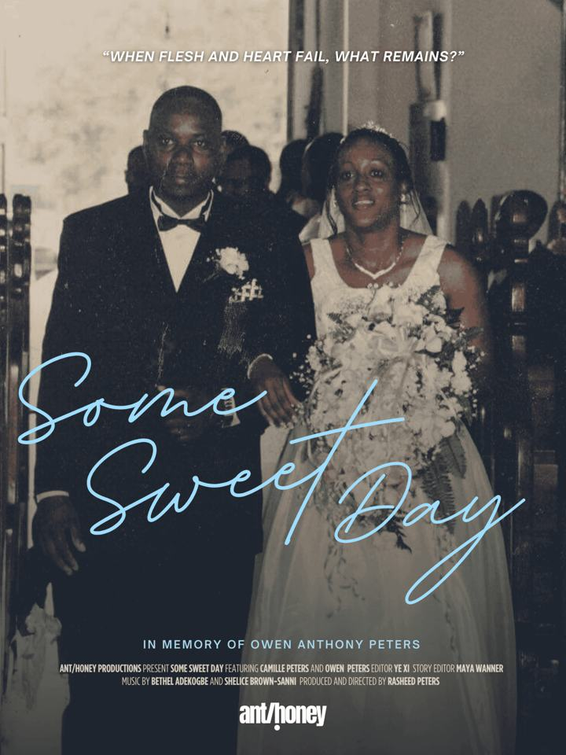

*Some Sweet Day* is a **19-minute, 36-second experimental personal documentary** directed by **Rasheed Peters**. Following Peters and his mother, **Camille**, after the death of his father, **Owen Anthony Peters**, the film explores grief, difficult emotions, regret, and the ways family memories endure. Filmed between Jamaica and the United States, it brings together an intimate mother-and-son conversation, family photographs, wedding footage, and funeral footage.

## My contribution: original music

I am credited for **original music**, alongside **Shelice Brown-Sanni**. This film grew from *Dead Yard*, the four-channel installation for which I produced, composed, recorded, arranged, mixed, and mastered the accompanying EP. That earlier work used music informed by Jamaican mourning songs and hymns to support the installation's story of loss and remembrance.

*Some Sweet Day* carries that creative collaboration into a distinct cinematic form. I am presenting my contribution here specifically as **original music for the film**, not as film direction, picture editing, or final film sound mixing. The film's official EPK credits **Ye Xi** with sound design and mix.

  <a class="portfolio-link" href="/#project/dead-yard/full">Explore the earlier Dead Yard music-production project ↗</a>
  <a class="portfolio-link" href="https://soundcloud.com/bethelade/sets/dead-yard" target="_blank" rel="noopener noreferrer">Listen to the Dead Yard EP ↗</a>

## Watch the official trailer

<iframe title="Some Sweet Day — official trailer" src="https://player.vimeo.com/video/996693751" loading="lazy" width="100%" height="380" allow="autoplay; fullscreen; picture-in-picture" allowfullscreen></iframe>

  <a class="portfolio-link" href="https://vimeo.com/996693751" target="_blank" rel="noopener noreferrer">Watch the trailer on Vimeo ↗</a>
  <a class="portfolio-link" href="https://www.rasheedpeters.com/ant-honey/some-sweet-day" target="_blank" rel="noopener noreferrer">Official film page — Rasheed Peters ↗</a>

## How the film developed

Rasheed Peters's director's statement explains that the original project began as an exploration of **anticipatory grief** during his father's long illness. After his father's passing in 2022, Peters created *Dead Yard* (2023), an immersive installation drawing on Jamaican mourning traditions and family stories. The project later evolved into *Some Sweet Day*, a more intimate, single-screen documentary focused on his mother's experiences as a grieving wife and parent.

The film was **completed October 2, 2023**; the creator's official film page identifies it as a **2024** short documentary. The distinction matters: 2023 is the completion year, while 2024 is the year of its prominent festival presentations.

## Festival and screening selections

The film's FilmFreeway screening record documents **six official selections**:

- **Chicago Filmmakers — SEEN, Volume 17**
- **Iowa City International Documentary Festival**
- **Windrush Caribbean Film Festival**
- **Conch Shell International Film Festival** — **2024 New York City premiere**, according to the festival organizer
- **Full Spectrum Features — Our Right to Gaze**
- **Black Harvest Film Festival**

These are festival or screening selections, **not award wins**.

## Film credits

- **Director, producer, cinematography:** Rasheed Peters
- **Editor and film sound design/mix:** Ye Xi (also credited as Xi Ye in the FilmFreeway materials)
- **Story editor:** Maya Wanner
- **Original music:** Bethel Adekogbe and Shelice Brown-Sanni
- **Color and graphics:** Ella (Eleanor) Harmon
- **Featured:** Camille Peters

The film is dedicated to the memory of **Owen Anthony Peters**.

## Poster

<figure style="margin:20px 0;max-width:680px">
  
  <figcaption style="font-size:12px;color:#b9b9c1;margin-top:8px">Original film poster. The project tile uses a square-safe version so its title stays visible.</figcaption>
</figure>

## Sources and screenings

  <a class="portfolio-link" href="https://www.rasheedpeters.com/ant-honey/some-sweet-day" target="_blank" rel="noopener noreferrer">Official film information ↗</a>
  <a class="portfolio-link" href="https://filmfreeway.com/SomeSweetDay" target="_blank" rel="noopener noreferrer">FilmFreeway listing and selections (project may request a password) ↗</a>
  <a class="portfolio-link" href="https://app.entertainmentoxygen.com/feed/some-sweet-day-ca05ebdb83a8" target="_blank" rel="noopener noreferrer">Entertainment Oxygen — film and composer credit ↗</a>
  <a class="portfolio-link" href="https://conchshelliff.com/f/jamaican-heritage-filmmakers-screen-at-conch-shell-intl-film-fest?blogcategory=Filmmaker" target="_blank" rel="noopener noreferrer">Conch Shell International Film Festival — 2024 NYC premiere ↗</a>
  <a class="portfolio-link" href="https://chicagofilmmakers.org/2024-screenings-and-events/chicagoseen17-virtual" target="_blank" rel="noopener noreferrer">Chicago Filmmakers — SEEN, Volume 17 ↗</a>

